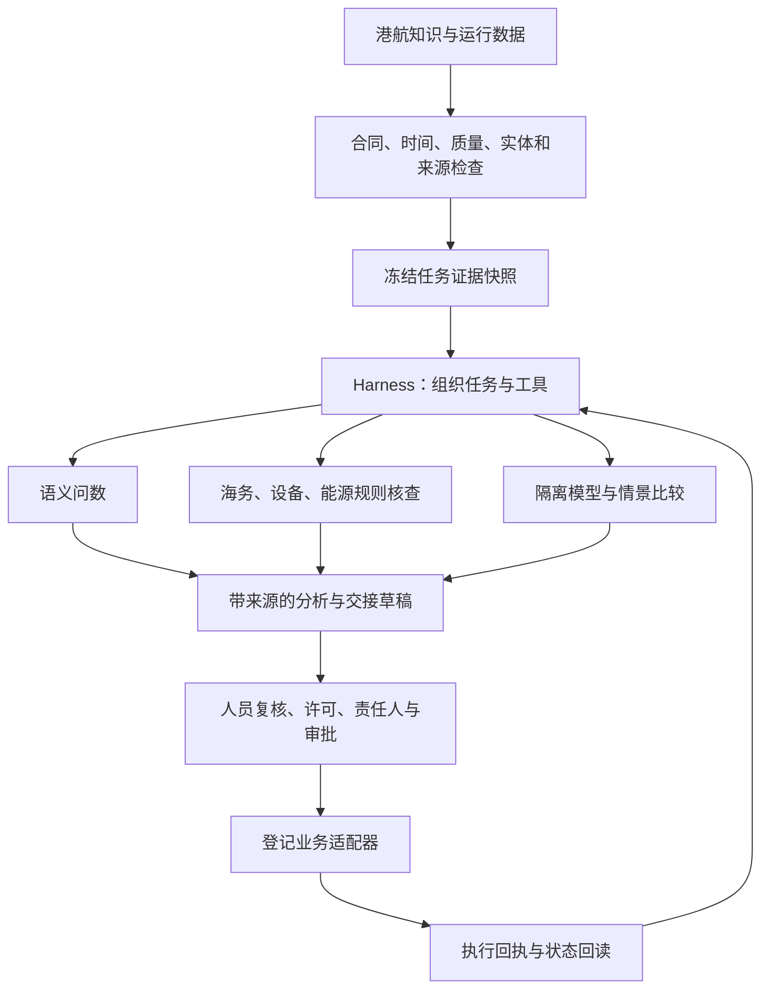

# 小懿港航业务与 Harness 评审、补强记录

评审日期：2026-10-29。项目：`/Users/apple/Desktop/小懿AI`。本报告以当前代码与本机实际执行为依据；公开产品能力、工程推断和小懿已验证能力分别说明。

## 先给判断

小懿原来的优势是有港航知识、模拟数据、业务工具与受控联动，上轮又补齐了任务循环、检查点、审批、恢复和轨迹。它已经超过一个普通聊天界面，但**执行系统完整，不等于港口决策能力完整**。此前最缺的是：问数语义、数据时效、同基线实验、专业约束，以及能交给下一班接续核查的业务产物。

本轮已补四个业务工具、三个任务模板和可读结果表，并修复原模拟器零电量漏计。它现在可以完成“采集同一份快照—问数—风险筛查—隔离情景对比—交接草稿”的实际闭环。它仍是公开数据校准的工程模拟与决策支持系统，没有获得真实港口生产权限，也没有达到与大型港口生产体系等价的验收条件。

## 新加坡和 Hi-Dolphin 可以怎样理解

你提到的“dopin”应为中远海科 **Hi-Dolphin**。船视宝官方产品页披露了行业知识网络、智能问数、实时数据接口、智能体及MCP服务。公司2026年5月14日的公开记录也确认其整合智能体能力，应用涵盖知识问答、船港分析和能耗优化。这支持“模型与业务数据、工具结合”的判断；其内部调度、租约、审批、沙箱或具体框架没有在这些材料中完整披露，不能推断为某个已知开源Harness。[产品页](https://about.myvessel.cn/solutions/smart-shipping)、[公司公开记录](https://static.cninfo.com.cn/finalpage/2026-05-14/1225306330.PDF)

新加坡需要区分 **MPA海事主管机构的海事数字孪生**与 **PSA码头运营体系**。MPA披露了与GovTech开发的数字孪生、实时船舶监测及相关可视化；其大士港说明涉及交通态势、AGV、自动化设备和远程管理。PSA披露了港口运营系统、自动化和数字孪生能力。这些资料支持“数据、仿真、运营系统协同”，没有证明其全部采用LLM Agent，更没有披露一个统一的内部Harness实现。[MPA数字孪生](https://www.mpa.gov.sg/media-centre/details/singapore-advances-maritime-innovation-with-geospatial-partnerships-and-launches-maritime-digital-twin)、[MPA大士港](https://www.mpa.gov.sg/maritime-singapore/port-of-the-future)、[PSA](https://www.globalpsa.com/psa-international/)

**下面是适用于港航业务的建议架构，属于工程分析，不是对上述机构内部架构的披露。**

一个更具体的公开例子来自新加坡海事研究院2026版路线图：研究人员使用LLM从事故文字中抽取要素，与AIS、挂靠、船龄等信息融合，再由机器学习模型估计船舶风险，最后通过LLM解释结果。这体现了语言模型、预测模型和数据工具的分工；这里描述的是研究方向，不能当成所有港口已部署的统一方案。若把这样的流程产品化，Harness可以组织步骤、保留中间证据、处理失败和人工复核。[SMI路线图，第43页](https://www.maritimeinstitute.sg/wp-content/themes/consulting-child/assets/roadmaps/tech-research-2035/flipbook.pdf)

LLM适合把问题转成分析步骤，Harness负责上下文、工具、状态、权限和证据；确定性算法负责计算、资源约束和联锁。PLC、设备防碰撞或高速交通控制不能交给当前按几十秒至分钟响应的语言模型循环。

## 从港航业务看，不足在哪里、这次改了什么

| 问题 | 原先不足及业务影响 | 本轮改进 | 当前边界 |
| --- | --- | --- | --- |
| 数据时效 | “刚请求了接口”不保证其每个设备和计量字段都新鲜 | 检查根时间、设备/挂靠事件时间、能源与气象观测时间；拒绝未来或无时区时间；检查合同、序号一致性、质量和功率平衡；记录检查时间，不把历史检查结果展示成当前有效 | 已接本机数据合同；未验证外部港口源的延迟分布与时钟同步 |
| 口径与单位 | RAG回答和完整JSON不便精确问数，容易混淆功率与电量 | `maritime.query`：12个版本化指标、6个实体数据集，保留值、单位、字段路径、查询摘要和快照摘要 | 不是任意SQL，也不是覆盖所有表达的自然语言问数系统 |
| 实体匹配 | 模型文字中的“这艘船、该泊位”可能指代不清 | 按挂靠ID、IMO、MMSI、船名及设备/泊位主键精确匹配，披露歧义、缺失和截取页 | 是受限实体查询，尚无完整航运知识图谱和跨来源实体消歧 |
| 比较公平性 | 不同时间读取、切换共享场景，会把基线变化误认为方案收益 | `twin.compare`：同种子、时钟、序号、已执行状态、校准文件和源码版本，在独立实例采样；先验证基线指标能复现 | 是条件情景采样，未实现完整的港口优化器、排队网络或独立动力学验证 |
| 专业风险 | 工具调用成功不能证明海务、设备和能源条件满足 | `maritime.risk`：UKC、风速、故障、低SOC、需量、堆场和功率平衡筛查；每条保留规则、值、阈值、字段与依据 | 阈值为显式工程筛查参数；实际港口制度、设备手册和作业许可仍需核对 |
| 零值 | 原逻辑将0% SOC视为缺省值，漏计低电量车辆 | 修复原模拟器告警、建议和汇总的三处判断；新问数保留零值，未知保持空值 | 未据此宣称电池模型已完成实船校准 |
| 容量统计 | 简单平均箱区占用率可能因箱区大小不同而失真 | 新指标使用总占用TEU/总容量TEU；保留计算口径 | 不替代箱型、危险品、堆高、翻箱及出口窗口约束 |
| 交接闭环 | 最终回答缺少待核实事项和接续责任 | `maritime.handover`：只接受同基线的问数、风险及对比证据，生成交接草稿；交付时再次检查数据是否过期 | 不伪造实名签收、工单、人员或截至时间，未填项明确保留 |
| 多专业协同 | 并行工具容易被误称为多智能体专家组 | 明确划分海务、码头、设备、能源核查项，并披露当前采用确定性规则 | 没有把四个专业域包装成四个独立模型或专家投票 |
| 交付可读性 | 工具工件只有原始JSON，不便业务人员审阅 | 新增问数、风险、情景对比表；保留原始JSON、来源、单位、假设和窄屏滚动 | 本轮实际验收Chrome，未覆盖所有原生桌面壳 |

尤其不能把“大风情景功率更低”解释为“更优节能策略”：较低功率可能来自作业受限。系统现在把压力情景与优化方案分开标识，不自动计算没有业务授权的综合排名。

## 新增的实际业务流程

小懿左侧 **Harness任务工作台 → 业务任务** 可选择：

1. **港区结构化问数**：采集本任务快照，查询电网需量、岸电负荷、低电量AGV和闸口队列。查看结果能看到单位与来源字段。
2. **同基线孪生情景对比**：采集快照、检查风险，再比较常态、需量高峰和大风等登记情景。当前原场景和运行ID不变。
3. **港航联合研判与交接**：依次执行上述问数、风险及情景对比，再生成带引用的交接草稿。

选择模板只填写目标和预算；点击“开始任务”后才执行。模型与规则模式继续明确区分。规则流程用于可复现业务链路；它的成功率不能当成自主模型智能水平。模板交付条件由后端强制检查，不能通过少传必需工具绕过。

所有业务工具引用当前任务的成功快照结果，例如 `source_ref=T1`。跨任务引用、工件摘要变化、不同快照混用、校准文件或模拟器版本变化、基线无法复现时，停止相应分析。

## 数据过期或缺失时怎样处理

能够读取历史数值与能够提出当前操作建议是两回事。系统可以展示数据及问题，但数据不新鲜、质量未通过或计量失衡时，风险与交接结果将建议状态标为 `withheld`。即使数据可分析，`operational_release` 仍为 `false`，表示不能据此放行现场作业。

交接时会重新检查原快照的年龄，避免前一步有效、等模型回答或人工等待后已经过期的证据继续支撑当前建议。原始快照与已有结果保留，便于追溯；不会悄悄换一份新快照并继续声称同基线比较。

## 验收与证据

证据目录：`.codex_artifacts/harness-maritime-20261029/`。回归、规则、模型和浏览器分别记录，未把它们合并为一个总体准确率。

| 验收 | 结果 | 证据 |
| --- | --- | --- |
| Python完整回归 | 572项通过，含本轮新增46项港航专项 | `pytest-final.txt` |
| Node原行为回归 | 46项通过 | `node-final.txt` |
| 港航专项及上轮运行层 | 102项通过 | `targeted-tests.txt` |
| 实际规则业务模板 | 3/3通过，5步联合研判实际生成同基线交接结果 | `rules-acceptance.json` |
| 实际本地模型 | 港区结构化问数通过，实际调用快照与问数工具；4次决策、5603 token、127.14秒 | `model-acceptance.json` |
| 最终模型工具流程与正式交接 | 6次模型决策、5次实际工具调用、7691 token、124.382秒通过；报告由已核验工件编译，`model_authored=false` | `model-tool-report-acceptance-v5.json` |
| 实际Chrome工作台 | 12项通过，无页面运行错误；含新增联合研判、单位与对比表、窄屏、同基线与不改变当前场景 | `browser-acceptance.json` |
| 原有主页面 | 六个主页面可正常切换，无JS运行错误；未据此声称所有外部系统在线 | `original-navigation.json` |
| 原始索引与配置保护 | 知识索引、向量索引、模型注册表、依赖锁摘要保持一致 | `protected-files-final.json` |
| 静态检查 | Ruff、编译、JS和Shell语法、差异空白检查通过 | `static-checks.json` |

模型实测使用既有本地4B模型，没有训练或替换权重。127.14秒是一个代表任务的端到端时间，不是P95、SLA或通用准确率。本轮没有重测真实马六甲写操作；上轮相关审批与恢复的历史证据仍保留在原报告，本轮不把历史回执冒充重新执行。

最终联合交接的124.382秒同样只是本机代表任务；不能直接外推到不同负载、不同模型或现场环境。此前问数任务按其原完成时间执行新增检查，复核结果保存在 `model-query-business-review.json`，没有把复核冒充最终版本重新跑过模型。正式报告的程序编译方式在任务创建时已经确定并告知用户，不是运行失败后悄悄将模型输出换成规则文本。

新增测试覆盖了：过期/未来/无时区数据、根时间新鲜而单设备过期、零SOC与未知值、加权占用、精确实体匹配、截取披露、禁止SQL、任务/工件隔离、五种基线的重复复现、独立实例不改原状态、校准/源码/字段变化拒绝、现场数据误套模拟模型拒绝、功率失衡、不同基线交接拒绝、必需条件不能削减，以及交付时过期抑制建议。

完整模型任务的首次联调在四个工具成功后，因默认累计token预算的剩余量无法容纳下一轮上下文的保守预检而停止。失败回执保存在 `model-briefing-acceptance-v1.json`。已为业务模板设置与工作量匹配的默认预算：联合研判32000、情景对比24000、问数16000 token；显式用户预算优先，实际生效预算参与幂等摘要。模型工具引用还绑定到本任务已成功的来源编号，避免虚构或混用引用。不能把这次预算失败删除后只报告成功。

第二次联调已实际完成五个工具，但最终摘要阶段的长上下文超过本机单次请求时限，回执保留为 `model-briefing-acceptance-v2.json`。针对这个原因，新增按业务阶段整理上下文：固定流程的中间阶段保留全部结果ID、工具、工件和摘要索引；最终阶段重点读取编译后的交接摘要及其尾部未决项。完整工具数据仍保存在原工件中，原始目标、全部补充约束不删减；用户追加要求时关闭这项固定流程整理。风险和暂缓建议状态放在摘要开头，防止被截在长数据后面。

第三次实测在203.966秒内完成五个工具及最终回答，机制检查通过，但逐句审阅发现模型摘要中的“未发现显著差异”没有统计检验支持。原文件 `model-briefing-acceptance-v3.json` 的成功标志只代表当时的机制评分，不作为业务声明正确的证据。按原完成时间执行新增检查，结果见 `model-briefing-v3-business-review.json`：该摘要未通过业务声明检查，历史记录未被改写。

已进一步补强：交接摘要开头保留各情景的实际需量、差值和风速；不再让模型只看到被压缩掉比较事实的长报告前言。新声明检查拒绝部分未经支持的显著性、最优性和“全部符合要求”表述，并在最终回答发布时再次计算原快照的时效。摘要不合格时最多进行两次有反馈的修正，仍不合格则阻止发布。过期时，最终通知也明确写出建议暂缓。这些规则是有限的业务检查，不是完整语义理解或独立专家认证。

第四次实测中，本机4B模型的三次自由摘要仍未通过新增检查，任务已阻止发布，原始结果保存在 `model-briefing-acceptance-v4.json`。这项模型能力不足没有被标记为修好。正式业务交付因此采用明确的结构化政策：选择“港航联合研判与交接”模板时，模型负责工具决策，完成五个成功工具后直接编译并核验交接工件，不再请求模型重写业务事实。任务、界面和回执均标明 `verified_business_report`、`model_authored=false`；它不是静默规则回退，也不构成模型自主撰写能力的证据。一般模型任务仍保留原生成与审查逻辑；用户追加要求会关闭自动交付，避免忽略新约束。

## 仍然缺少什么

这些差距需要继续建设，不能由本次功能补充自动获得：

- **真实数据与业务接口**：没有取得新加坡、上海或中远生产数据的访问权；也没有新增现场TOS/PCS、AIS授权服务、计量或气象水文接入验收。
- **模型与动力学可信度**：现有模拟器的SOC等仍是序号驱动工程示例，尚无完整电池充放电状态积分与现场校准。新增情景工具不是设备续航、长期能耗或气象预测器。
- **优化决策**：尚无经过独立校验的泊位—岸桥—堆场—车辆联合约束优化、完整资源冲突求解或经济收益评估。不能将几个压力情景当成最优调度。
- **知识覆盖与时效**：受限指标目录不等于完整知识图谱；本轮没有复制Hi-Dolphin的知识规模、全球数据覆盖或专业题库。法规与港区制度还需要维护辖区、版本和生效状态。
- **业务协同**：交接是草稿，尚无企业工单、实名签收、值班排班、截止时间升级和多组织协同闭环。
- **工程规模与生产准入**：仍缺少多机目标事务、企业IAM、远程MCP客户端互操作、长期耐久与负载测试，以及现场联锁和安全准入。
- **独立质量评测**：本轮使用公开能力对照、本地专项和代表任务，没有进行同条件跨引擎盲测；这些结果不证明达到国际顶级综合性能。

因此，面试中可以准确地说：**“我在港航助手上实现了持久任务Harness，并把业务证据、语义问数、风险核查、同基线隔离情景与交接产物接进同一个可审计闭环；对真实数据、模型保真度、生产控制和独立评测的边界做了明确处理。”** 不能说已经复刻PSA、接入中远内网，或已经验证现场收益。
