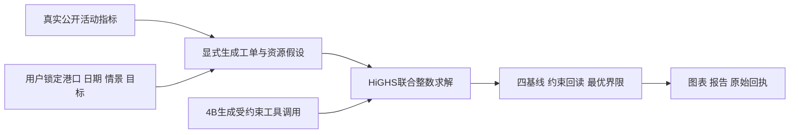

# 小懿V5：逐项提升、实证演示与操作指南

日期：2026-10-30。定位：公开真实数据驱动、显式假设下可复现的港航工程研究与受控工具平台。严格港口验收仍5/11，生产权限关闭。

本轮实质新增的是联合资源—供电优化、现场参数重算和可核验演示；没有将旧RL、年度孪生或现场缺项改成通过。37项均有本轮处理记录，部分只是增强核验入口或保留缺口。

## 这次能拿出来证明什么

- 8个此前未用的国际港口：Algeciras、Genova、Colombo、Mundra、Hai Phong、Manila、Barcelona、Osaka；22,096条真实公开逐日记录。来源仍是已固定版本的IMF官方完整导出，不冒充新的供应商或实时遥测。
- 联合整数优化同时约束泊位长度、引航拖轮、岸桥、集卡、堆场、岸电和可靠供电；同输入对比FIFO、交期、优先级短工期和分时能耗前瞻四种启发式。公开指标只确定合成工单规模，个船工期、船长、设备和价格均是显式假设。
- 可查看最优界限、等待、延误、电量和峰值；不把目标分值称为真实财务收益，不将固定工单的电量差异包装成实测节能。
- 所有科研图表能定位到原始轨迹；阴影是原冻结区间；无观测单元保持空，不补成虚构真值。
- 四类副本故障的阻断/恢复、同请求重试、身份隔离、回执完整性和热修改源码后拒绝执行有实际或回归证据。
- 实际4B模型可以生成受约束的优化工具调用。该模板只有一个必需工具，参数由用户锁定，不能据此宣称开放式自主选工具、复杂自由规划或模型自行求解；HiGHS负责整数求解，报告由核验工件汇总。

## 前沿方向与本轮实现的对应关系

参考[MPA/SMI2026路线图](https://www.mpa.gov.sg/media-centre/details/singapore-maritime-technology---research-roadmap-2026-edition-to--advance-maritime-innovation-and-capabilities-development)的智能集成港口服务、生产率与资源约束方向，补强共同资源求解；参考[DCSA PortCall2.0](https://reference.dcsa.org/content/standards/releases/port-call/v2)核对协同时序。没有机构为本项目评分背书，也没有获得外部一致性或现场运行认证。

## 八步现场操作与通俗解释

打开 **http://127.0.0.1:8010**，点击左侧/更多入口中的 **小懿能力实证演示**。页面顶部按“执行本步并等待回执 → 下一步”推进；未执行不能前进。跳过会保留“未演示”记录。关闭后可恢复历史，导出包不会将跳过项当成通过。

|步骤|实际操作|通俗讲法与核对点|
|---|---|---|
|1 证据问答|输入现场问题；可选辖区、适用日期；点真实检索|说明“先找哪些依据”，展开原始命中。此面板是索引与证据约束回答；原生智能对话才走4B自由生成链。证据不足也会显示。|
|2 运营事实|读取运营事实并隔离推演|同一个当前工程模拟快照产生问数、风险和情景分支，核对单位、时间和快照摘要。数据模式仍是工程模拟。|
|3 联合优化|选港口、日期、情景和容量；切换目标后重算|例如把2600kW改为1800kW，观察排程、暂缓、等待和峰值的变化。查看四基线、求解间隙及假设，不保证每次都有改善。|
|4 RL回放|选择港口、1月/4月和压力情景|查看90天真实保存的原始动作、过滤动作、队列、成本及来源截止日。安全RL与安全MPC重合即表明没有额外RL收益。|
|5 孪生核验|逐一选择56个单元，包括失败和缺测|核对预测、真实观测、强基线和原区间。Fremantle缺观测时保持空；七日任务不能替代年度任务。|
|6 故障阻断|点故障注入、阻断和恢复|四种副本故障分别为时间过期、功率失衡、序号错配、缺能源域；看具体阻断检查和恢复摘要。未操作真实OT。|
|7 运行核查|读取当前运行状态|说明当前进程、索引和模型是否就绪。单次ready不等于长期SLO或高可用。|
|8 模型驱动|点真实4B调用优化工具，等待完成|界面参数会锁定到任务。查看模型名、token、工具调用和回执；生成格式与执行层都不能改写锁定参数。此单工具模板不证明通用自主规划。|

额外入口：**DCSA协同时序与异常演练** 实际运行固定技术时钟的E-R-P-A四阶段与13项本地回归。另补9项单因素语义核验：每例先接受有效前置事件，再对齐技术时钟，核对预期错误和无部分写入。原13项不能解读为13种独立攻击，外部一致性测试仍为false。详细追加结果在37项能力的DCSA卡及开发记录中。

**公开数据原文件**可下载原CSV，浏览器会自动核验SHA256。**导出本次演示证据包**包含真实执行、原始输入、失败、缺测、模型回执和未演示步骤；不是所有37项业务已全面验收的证明。

常规读取/求解通常是秒级；本机CPU模型受负载影响可能需要数十秒至数分钟。先等回执再推进，不重复点击创建模型任务。

## 两批评估结果：保留收益变小和零改善

|批次|留出性质|案例|最优性证明|有改善 / 无改善|平均目标改善|中位数|最大改善|
|---|---|---:|---:|---:|---:|---:|---:|
|2026-05-18|首次八个新港的合成工单任务|32|32|12 / 20|1.1144%|0%|15.7223%|
|2026-06-15|相同八港的新日期；不重复称为整港未见|32|32|5 / 27|0.3662%|0%|2.5940%|

比较对象为同输入下四个可行启发式中最好的一个，不是RL超过强MPC或真实港口经济增益。第二批较小收益保留；没有针对留出再调整权重。初始源代码仅将局部变量l改名为late_hours以符合lint，旧代码和5月结果完整保留，新6月协议在评分前注册。最终报告原泛化“new-port”措辞有单独元数据更正，原JSON及数值完全保留。

复核：独立小规模穷举单测核对最优值；新6月32例×5种排程重新读取源CSV、重建冻结问题并回读约束和成本，共160份排程，最大数值误差0。回读复用了独立于求解矩阵的检查器，不称为外部同行评审。

## 37项逐项处理与评分

评分仍沿用五维0—4相加乘5；属于本次证据成熟度判断，不是世界排名。新增核验入口不会自动提高分数。

|功能|原分 → 当前|本轮处理|仍缺什么|
|---|---:|---|---|
|港航知识问答|55 → 55|新增现场输入问题、辖区和日期的证据问答面板；回答和每条原始检索证据可导出。|固定题与本地案例有证据；陌生港口业务人员盲评和全球知识覆盖不足。|
|语义检索与Hybrid RAG|65 → 65|可展开实际检索命中与来源字段，保留证据不足；未把界面增强折算为召回率提升。|882分块属于有限知识快照，固定题高命中不能推算开放世界准确率。|
|多轮理解与问题拆解|55 → 55|新增模型—工具任务状态和历史恢复；开放长对话盲测仍未完成。|缺大量未见长对话、指代冲突及跨工具长程盲测。|
|SOP与风险提示|60 → 60|增加四类副本故障和未知UKC阻断示例，逐项显示触发检查与恢复。|建议性质；没有港方现场操作签收和真实事故复盘验证。|
|法规辖区、时效与冲突治理|60 → 60|现场传入辖区、适用日期并展示实际证据；没有新增全量法规覆盖。|登记范围有限，缺持续全量法规更新与外部专业审查。|
|报告与交接草稿|60 → 60|增加同一快照问数、风险和情景证据包，正式交接仍走已有任务链与责任人复核。|草稿需业务责任人复核，尚无机构正式签收。|
|结构化问数与业务分析|60 → 60|同一快照的单位、字段、时间及摘要一起显示，可实际重取并追溯。|现场数据连接未验证，模拟字段完整度不等于实测字段完整度。|
|本机4B生成模型|40 → 40|新增实际4B选择联合优化工具；用户参数在生成格式和执行层双重锁定，模型不冒充优化器。|基础能力来自开放权重；未做与前沿基础模型的同条件独立盲测。|
|LoRA训练与领域适配|30 → 30|本轮未重训LoRA；保留原训练/推理证据与质量准入阻断。|质量准入仍阻断；少量loss下降不证明业务质量或前沿模型水平。|
|Harness工具型任务工作台|75 → 75|新增真实优化工具、研究模板、参数绑定及核验报告，保留模型与算法责任分工。|可复现工程任务较完整；缺开放任务基准、跨机构长期运行和外部盲评。|
|检查点、租约、恢复与取消|70 → 70|新增演示回执身份隔离、同请求幂等、历史恢复；模拟响应丢失时可按原请求重取。|本地进程与SQLite证据；未覆盖分布式集群灾备或港口OT。|
|技能、显式记忆和MCP只读工具|60 → 60|证据问答和专业工具有现场核验入口，现有技能与显式记忆边界不变。|不等于自主学习全港知识；缺外部生态与陌生任务规模验证。|
|四系统联动与连续观测|70 → 70|原八个实际适配器另行复验；新演示不将私有副本故障当成跨系统写入。|连接的是已登记演示/研究系统；观测差值不自动构成因果收益。|
|受控模拟执行与回滚|65 → 65|新增四类故障副本恢复一致性核验；原目标系统配置回滚证据分别保留。|没有真实设备指令权限，组织身份及OT恢复尚未签收。|
|十域实时业务模拟|65 → 65|实时读取当前工程模拟快照并在隔离副本重算三种压力情景，避免静态截图。|物理容量、设备负荷和故障影响多为工程假设。|
|孪生可视化与跨端展示|50 → 55|新增原始真值、冻结预测、强基线、区间阴影，以及RL动作/积压和联合排程甘特图。|外部联动能力；几何和动画不能证明水深、设备或全港物理标定。|
|公开数据、来源与证据血缘|80 → 80|增加八个此前未使用港口、22096条公开记录，CSV可直接下载并核验摘要。|同源归档不等于实时现场遥测，历史修订/发布时间仍有不确定性。|
|跨港需求预测与区间|65 → 65|保留原预测留出与区间门禁；本轮没有用展示增强宣称新的预测精度。|是AIS活动指标预测；没有真实到港预约、现场发布时间和漂移SLA。|
|RL研究、消融与策略评估框架|70 → 70|新增按港口、季度、压力查看冻结策略的逐步原始/过滤动作与成本；未重训。|方法验证较完整，复杂多智能体真实港口任务与独立机构复核仍不足。|
|RL相对强MPC的有效收益|30 → 30|原收益失败保持；联合整数优化属于另一业务任务，不冒充RL超过强MPC。|安全版与安全MPC动作相同；没有额外RL收益准入，跨港相对成本和集中收益仍失败。|
|PID/MPC控制与强基线|55 → 55|新增同窗口RL与成本/安全MPC曲线和原轨迹对照，保留动作相同与退化。|五档容量代理问题；未完成真实设备动态、业务成本和控制链标定。|
|短期水位预测与因果同化|60 → 60|新增可核对的单元选择、真值和原区间；完整短期46/54门禁未改。|完整项46/54；缺测和实时传感器可用性仍阻断资格。|
|年度开环物理孪生|40 → 40|年度5/21仍失败；七日曲线和短期同化不能替代年度资格。|年度新留出5/21；稳定跨年/跨季标定尚未通过。|
|逐次天气预报强迫的七日孪生|50 → 50|56个历史单元可逐一查看原预测/真值/强基线，缺测单元保持空。|两种模式均15/28；覆盖、基线和数据可用性仍失败，不能替代年度资格。|
|引航、泊位、岸桥和堆场排程|40 → 50|新增HiGHS整数联合优化、四个启发式基线、求解界限和独立小规模穷举校验。|缺真实船舶工单、港区布局、服务时长和效率标定。|
|能耗、储能与碳核算|45 → 50|把岸桥、岸电与引航/堆场用电纳入联合容量约束和分时目标；未知碳因子不补造。|未取得港口电表、设备工况及可核验电网因子，不能宣称实测节能减排。|
|全港多业务物理闭环|35 → 40|新增工单原子完整、泊位长度、资源时隙和可靠供电的共同求解；现场物理标定仍缺。|水深/吃水/基准、设备能耗和全港实际业务数据仍缺，现场物理闭环未成立。|
|DCSA/MSW多机构协同|35 → 35|新增一键实际执行DCSA官方规范子集、E-R-P-A四阶段与13项契约/异常演练，原事件字段和固定技术时钟可导出；尚无外部一致性签收。 补充9项独立前置条件/技术时钟对齐的单因素语义核验，检查预期错误与无部分写入；分数仍35。|尚无完整外部一致性测试、MSW接入、机构身份或签收。|
|航行/运输模型联动|50 → 50|保留外部航行/运输模型联动证据；未宣称新增完整实船航次验证。|属于外部系统联动；缺真实航道、硬件和端到端RL训练验收。|
|移动与客户端签收|50 → 50|新增窄屏实证工作台核验；原生客户端窗口和全设备签收缺口不抹去。|原生桌面窗口既定验收仍未通过；历史签收不能当作当前全设备兼容证明。|
|审计回执与执行证据完整性|80 → 80|新增身份绑定演示回执、结果/输入摘要、事件链、完整失败与整场证据导出。|本地SHA一致性尚无外部签名、独立不可篡改存证和多方取证。|
|权限、注入防护与供应链|60 → 60|新增优化参数生成格式常量绑定、执行层复核、身份隔离及篡改检测回归。|缺外部红队、真实机构IAM/密钥及OT网络安全验收。|
|监控、健康和故障诊断|65 → 65|四类可控副本故障可显示具体阻断检查，并核对恢复后的原始摘要。|本机时点/历史持续探测证据，缺多站点长期SLO和高可用实测。|
|Docker发行与可复现部署|70 → 70|最终当前源码重新实建并验收；仍不宣称容器内4B推理或多站点高可用。|单机Linux容器；未验证高可用集群、灾备、现场运维或容器内4B推理。|
|真实港口只读接入准备|25 → 25|新增公开来源下载和校验入口；真实港口只读现场准入仍是单独七项门禁。|没有完成港方现场七项准入；真实接入完成度仍为0/7。|
|真实港口自主调度|0 → 0|没有真实港口签字与现场授权，本轮保持0分和生产权限关闭。|没有签字授权、现场HIL、影子运行和生产调度资格。|
|视频/雷达多模态感知|0 → 0|未接入已验收的视频/雷达感知链，本轮保持0分，不用动画替代感知证据。|没有已验收的真实港口视频识别、雷达融合或视觉闭环。|

## Docker问题及验收边界

构建在递归chown全部数据时遇到空间不足。COPY已设置文件归属，因此把chown限制到新生成索引和可写目录，避免对公开数据重复复制写入层。仅清理专用xiaoyi-build虚拟机中两个具名、已停止的旧容器/镜像和过期未使用构建缓存，保留当前旧版容器和全部卷；可用空间从约536MiB恢复到约2.9GiB。旧失败日志保留，最终实际构建回执另列。

严格港口验收仍未解除六项：RL相对强基线收益、年度物理标定、完整短期可用性、全港现场物理、多机构现场协同、现场安全运行。八港代理优化、图表和本机工程通过均不能代替现场参数、MSW/机构签收、OT/HIL和港口授权。

原年度5/21、短期46/54、天气强迫两模式各15/28以及RL准入false继续保留。本轮没有重新训练RL或重新标定水位模型。

## 交付文件

- [最新37项评分JSON](/Users/apple/Desktop/小懿AI/data/evaluation/xiaoyi_capability_scorecard_v5_20261030.json)
- [37项改进记录](/Users/apple/Desktop/小懿AI/data/evaluation/xiaoyi_capability_improvements_v5_20261030.json)
- [新日期完整结果](/Users/apple/Desktop/小懿AI/data/public/operations_v5_20261030/report-qualified.json)
- [9项协议单因素核验](/Users/apple/Desktop/小懿AI/.codex_artifacts/improvement-v5-20261030/standard-isolation.json)
- [开发失败和修复](/Users/apple/Desktop/小懿AI/.codex_artifacts/improvement-v5-20261030/development-failures.json)
- [最终验收总回执](/Users/apple/Desktop/小懿AI/.codex_artifacts/improvement-v5-20261030/ACCEPTANCE.json)

默认展示使用主机8010入口；容器18010仅作为隔离构建验证入口。镜像不包含主机4B权重与历史SQLite，不宣称容器内已完成4B推理。

## 最终验收回执

774项Python、47项Node、60项真实浏览器检查、8个实际本机适配器、15项实际容器检查通过。另有13项原本地规范回归和9项新增独立前置条件的语义核验。严格港口矩阵仍5/11；这些检查数不能相加当作智能等级。

最终浏览器内4B工具任务 `ht-a907c4c1d5364170ab55754c57dee72a` 完成，1次工具调用、1308 tokens；严格失败/评分/发行的实际模型只读审阅 `ht-a3e500b02ad944dfaeba3fec652199f9` 完成，2次工具读取、2493 tokens。两类正式报告均为核验工件汇总，非模型自由研究能力或第三方科学审稿。

最终镜像 `xiaoyi-ai:accepted-v5-20261030`，ID `sha256:8878a912dbc877629fad54eead7a56c1c6eeb3f9646196c79b9cc18fc94909b6`；285个源码及发行/检查配置文件与宿主一致。应用、测试、脚本和前端字节在全仓回归后保持不变；随后仅修改Dockerfile归属层和追加证据登记，发行检查重跑，Docker实际重建验证。

当前[原始总回执](/Users/apple/Desktop/小懿AI/.codex_artifacts/improvement-v5-20261030/ACCEPTANCE.json)与[当前镜像回执](/Users/apple/Desktop/小懿AI/.codex_artifacts/improvement-v5-20261030/container-retry/container-acceptance.json)可核查。运行服务的已加载版本与磁盘摘要一致，主机8010为展示入口。

曲线阅读说明：当前SVG横轴按保存点次序绘制，完整水位单元对应逐小时记录；部分缺测单元请同时核对原始lead_hours、n和availability。点间连线不表示缺口存在实测值，严谨的时间轴分析以原始时间戳为准。
