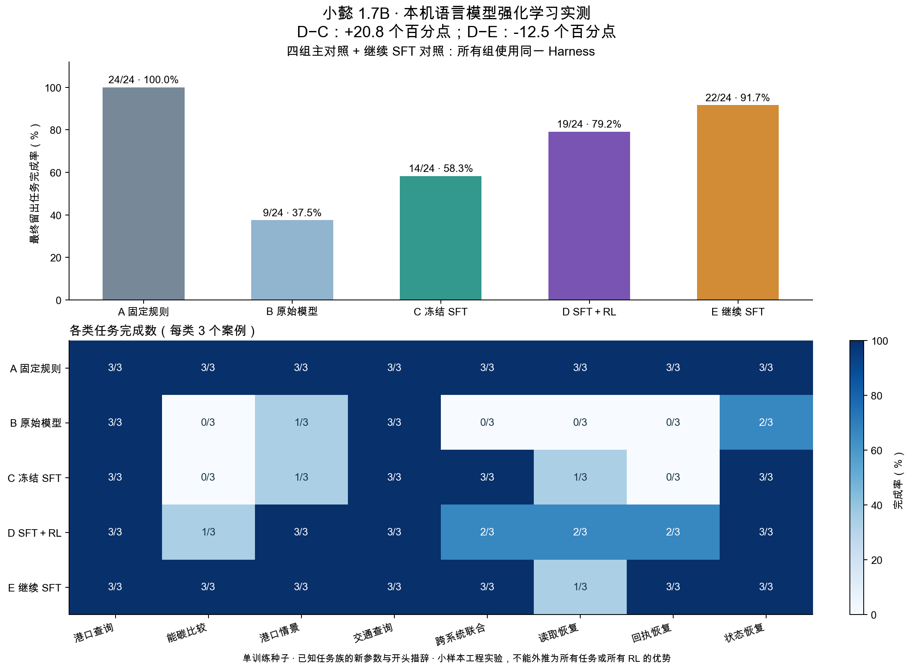
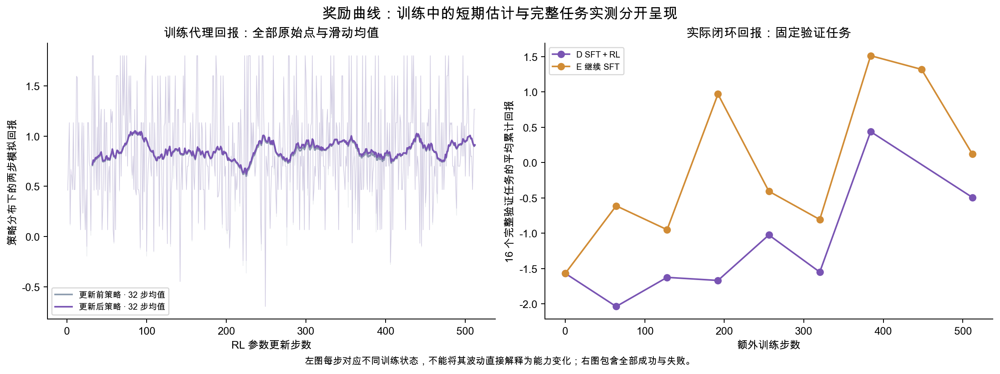
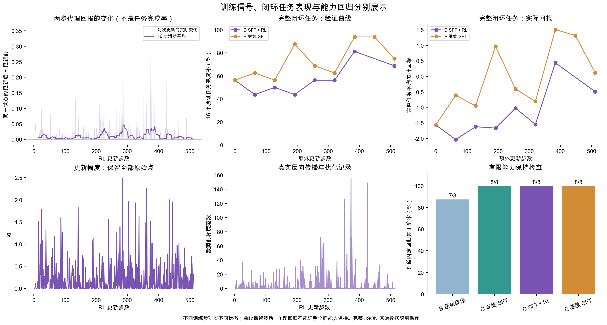
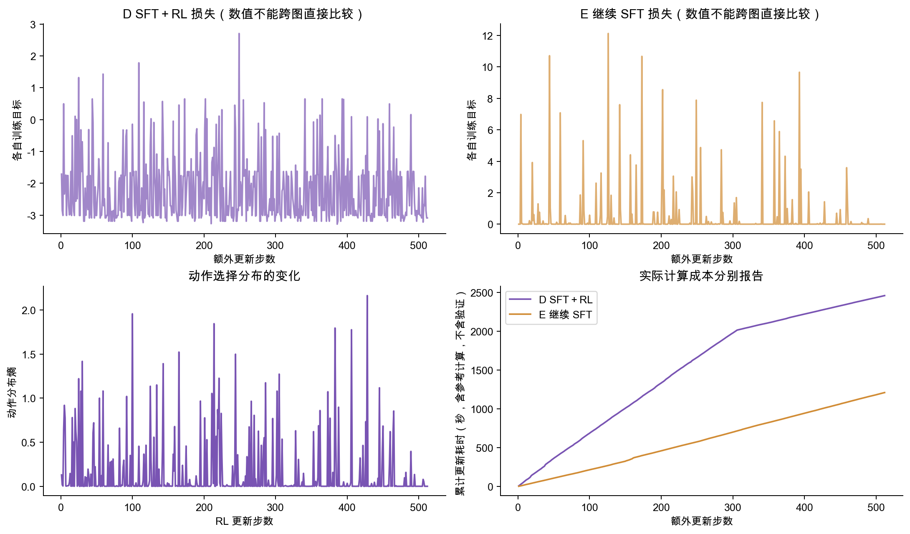
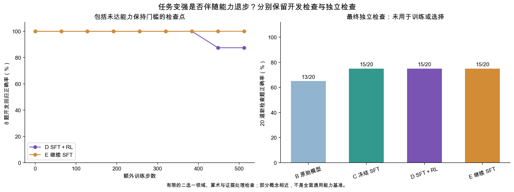

# 语言模型 RL 对照实验：公开证据

本目录是 2026-11-02 已冻结验收包的精简副本，实验编号 `experiment-004`。原 JSON、轨迹与图表按字节复制；`manifest.json` 记录其 SHA-256。完整训练检查点与分支记录见 [Release](https://github.com/wenjiayi123/xiaoyi-maritime-ai/releases/tag/harness-rl-20261102)。

| 组别 | 完成数 | 完成率 |
|---|---:|---:|
| A 固定规则 | 24/24 | 100.0% |
| B 原始模型 | 9/24 | 37.5% |
| C 冻结 SFT | 14/24 | 58.3% |
| D SFT＋RL | 19/24 | 79.2% |
| E 继续 SFT | 22/24 | 91.7% |

RL 高于冻结 SFT，继续 SFT 与规则的完成率更高。单种子、已知任务族、有限动作集合，不宣称统计显著或任意任务泛化。[完整方法与边界](../../../docs/GITHUB_RELEASE_20261102.md)。

- `audited-summary.json`：最终结果、指标定义、配对差异和局限。
- `tasks/`、`trajectories/`：任务定义及全部成功/失败轨迹；五组最终测试共 120 条。
- `training.jsonl`、`validation-curve.jsonl`：原始更新与开发验证记录。
- `checkpoint-selection*.json`、`selection-grid-amendment.json`：选择规则与测试前修订。
- `native/`：全部六次本机系统验收；C、D 均为 2/3。
- `previous-negative-run/`：第一轮 C=11/24、D=10/24 的负结果。
- `earlier-attempts/`：前两次尚未打开最终测试的尝试状态。
- `figures/`：PNG、SVG、PDF、原始绘图数据及来源指纹。

在仓库根目录执行 `python3 scripts/verify_published_agent_rl.py`，验证文件完整性并重放 120 条合成测试轨迹。完整参数/训练分支审计使用 Release 附件与 `scripts/audit_agent_rl_v2.py`。
